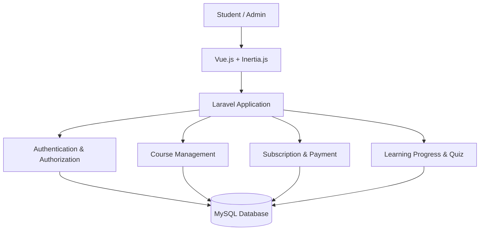

# ✨ Ilmora — Learn with Purpose

<p align="center">
  <strong>A Modern Learning & Subscription Platform</strong>
  <br>
  Platform pembelajaran digital untuk belajar, berkembang, dan meraih potensi terbaik.
</p>

<p align="center">
  
  
  
  
  
</p>

<p align="center">
  <a href="#tentang-ilmora">Tentang</a> •
  <a href="#fitur-utama">Fitur</a> •
  <a href="#teknologi">Teknologi</a> •
  <a href="#instalasi">Instalasi</a> •
  <a href="#struktur-proyek">Struktur</a> •
  <a href="#roadmap">Roadmap</a>
</p>

---

## 📖 Tentang Ilmora

**Ilmora** adalah platform kursus dan pembelajaran digital yang dirancang untuk menghadirkan pengalaman belajar yang terstruktur, fleksibel, dan mudah diakses.

Ilmora berfokus pada pengelolaan kursus, materi pembelajaran, progres siswa, serta akses premium melalui sistem langganan.
 
### 🎯 Visi

Membangun ruang pembelajaran digital yang membantu setiap orang mengembangkan pengetahuan dan keterampilan secara berkelanjutan.

### 💡 Misi

* 📚 Menyediakan pengalaman belajar digital yang terorganisasi.
* 🎓 Mempermudah pengguna menemukan dan mengikuti kursus.
* 🔐 Menjaga keamanan akun dan akses materi pembelajaran.
* 📈 Membantu siswa memantau perkembangan belajarnya.
* ⚙️ Menyediakan pengelolaan kursus yang efisien bagi administrator.

> **Learn with purpose. Grow with knowledge.**

## 🚀 Fitur Utama

Fitur berikut merupakan sasaran pengembangan. Status implementasinya perlu diverifikasi terhadap kode aplikasi.

### 👨‍🎓 Student Experience

* **Authentication** — Registrasi, login, dan pengelolaan akun.
* **Course Catalog** — Menjelajahi kursus yang tersedia.
* **Learning Dashboard** — Melihat kursus dan progres belajar.
* **Learning Materials** — Mengakses video, artikel, dan dokumen.
* **Subscription Access** — Membuka materi premium sesuai hak akses.
* **Learning Progress** — Melacak penyelesaian materi.
* **Quiz & Assessment** — Latihan untuk mengukur pemahaman.
* **Certificates** — Sertifikat setelah memenuhi persyaratan kursus.

### 🛠️ Administration

* **Dashboard Admin** — Ringkasan pengelolaan platform.
* **Course Management** — Mengelola kursus, modul, dan materi.
* **User Management** — Mengelola akun dan hak akses.
* **Subscription Management** — Mengelola paket dan status langganan.
* **Transaction Monitoring** — Memantau pembayaran dan transaksi.
* **Content Publishing** — Mengatur publikasi materi pembelajaran.

### 🛡️ Security & Reliability

* Validasi input pada backend.
* Autentikasi dan otorisasi berbasis peran.
* Perlindungan terhadap akses materi tanpa izin.
* Pengelolaan konfigurasi melalui environment variables.
* Automated testing untuk mengurangi risiko regresi.
* Integritas data melalui relasi dan constraint database.

## 🧰 Teknologi

| Teknologi      | Peran                                            |
| -------------- | ------------------------------------------------ |
| Laravel        | Backend, routing, autentikasi, dan logika bisnis |
| Vue.js         | Antarmuka pengguna yang interaktif               |
| Inertia.js     | Integrasi frontend Vue dengan Laravel            |
| Tailwind CSS   | Styling dan desain responsif                     |
| MySQL          | Database relasional                              |
| Vite           | Development server dan build frontend            |
| PHP & Composer | Runtime dan dependency backend                   |
| Node.js & npm  | Tooling dan dependency frontend                  |
| Laragon        | Lingkungan pengembangan lokal                    |
| PHPUnit / Pest | Automated testing, mengikuti konfigurasi project |

Versi dependency mengikuti `composer.json`, `composer.lock`, `package.json`, dan lockfile yang tersedia.

## 🏗️ Arsitektur Aplikasi

Ilmora menggunakan pendekatan **monolithic Laravel application dengan Vue dan Inertia.js** agar backend dan frontend dapat dikembangkan dalam satu project.



### Alur utama

1. Pengguna masuk ke aplikasi melalui autentikasi.
2. Laravel memverifikasi identitas dan hak akses pengguna.
3. Pengguna menjelajahi kursus yang tersedia.
4. Sistem memeriksa izin akses sebelum menampilkan materi privat.
5. Progres belajar disimpan sesuai aktivitas pengguna.
6. Sistem langganan mengatur akses premium berdasarkan status yang telah diverifikasi.

Integrasi pembayaran dan fitur pembelajaran lanjutan dilakukan secara bertahap sesuai kebutuhan produk.

## 📋 Persyaratan Sistem

Sebelum menjalankan project, pastikan perangkat telah memiliki:

* Windows 10/11 atau lingkungan pengembangan yang kompatibel.
* [Laragon](https://laragon.org/) dengan PHP dan MySQL.
* [Composer](https://getcomposer.org/).
* [Node.js](https://nodejs.org/) dan npm.
* [Git](https://git-scm.com/).
* Visual Studio Code atau editor pilihan.

Periksa instalasi melalui terminal:

```bash
php -v
composer --version
node -v
npm -v
```

## ⚙️ Instalasi

### 1. Clone repository

Jika repository sudah tersedia di GitHub:

```bash
git clone <REPOSITORY_URL> ilmora
cd ilmora
```

Ganti `<REPOSITORY_URL>` dengan alamat repository yang sebenarnya.

Jika project belum dibuat, kamu dapat membuat project Laravel baru melalui Laragon:

```powershell
cd C:\laragon\www
composer create-project laravel/laravel ilmora
cd ilmora
```

### 2. Install dependency

Untuk project yang sudah memiliki source code:

```bash
composer install
npm install
```

Jika repository menyediakan `package-lock.json` yang valid, `npm ci` dapat digunakan sebagai alternatif untuk instalasi frontend yang konsisten.

### 3. Konfigurasi environment

Buat file `.env` dari `.env.example` menggunakan PowerShell:

```powershell
Copy-Item .env.example .env
```

Generate application key untuk instalasi baru jika belum tersedia:

```bash
php artisan key:generate
```

**Catatan:** Jangan mengganti application key pada instalasi yang telah digunakan dan menyimpan data terenkripsi tanpa memahami dampaknya.

### 4. Buat database MySQL

1. Jalankan Laragon.
2. Start MySQL.
3. Buka HeidiSQL atau phpMyAdmin.
4. Buat database bernama `ilmora`.

Contoh SQL:

```sql
CREATE DATABASE ilmora
CHARACTER SET utf8mb4
COLLATE utf8mb4_unicode_ci;
```

### 5. Hubungkan Laravel ke MySQL

Atur konfigurasi database pada file `.env`:

```dotenv
DB_CONNECTION=mysql
DB_HOST=127.0.0.1
DB_PORT=3306
DB_DATABASE=ilmora
DB_USERNAME=root
DB_PASSWORD=
```

Konfigurasi ini menggunakan asumsi default Laragon yang umum. Sesuaikan username, password, dan port jika konfigurasi lokal berbeda.

### 6. Jalankan database migration

```bash
php artisan migrate
```

Pastikan migration yang tersedia sudah diperiksa sebelum menjalankannya terhadap database yang berisi data penting.

> ⚠️ Hindari `php artisan migrate:fresh` pada database yang berisi data penting karena perintah tersebut menghapus seluruh tabel sebelum menjalankan ulang migration.

## ▶️ Menjalankan Aplikasi

Jalankan Laravel dan Vite di dua terminal terpisah.

**Terminal 1 — Backend**

```bash
php artisan serve
```

**Terminal 2 — Frontend**

```bash
npm run dev
```

Buka browser:

**http://127.0.0.1:8000**

Biarkan kedua proses tetap berjalan selama development.

### Production build

Untuk membuat asset frontend siap produksi:

```bash
npm run build
```

## 🧪 Testing & Quality Assurance

Ilmora perlu mempertahankan kualitas kode melalui pengujian otomatis.

### Menjalankan test Laravel

```bash
php artisan test
```

### Memeriksa route

```bash
php artisan route:list
```

### Memvalidasi Composer

```bash
composer validate
```

### Build frontend

```bash
npm run build
```

### Area pengujian yang diprioritaskan

| Area              | Skenario                                         |
| ----------------- | ------------------------------------------------ |
| Authentication    | Registrasi, login, logout, dan validasi          |
| Authorization     | Pemisahan akses siswa dan admin                  |
| Course Management | CRUD kursus, modul, dan materi                   |
| Subscription      | Status aktif, kedaluwarsa, dan pembatasan akses  |
| Payment           | Validasi webhook dan pencegahan transaksi ganda  |
| Learning Progress | Pencatatan dan pembaruan progres                 |
| UI Integration    | Form, navigasi, tombol, loading, dan error state |
| Database          | Relasi, constraint, dan integritas data          |

Test harus dijalankan dan hasilnya diverifikasi sebelum perubahan dinyatakan siap digabungkan.

## 🔐 Keamanan

Keamanan merupakan bagian penting dari pengembangan Ilmora.

* Jangan commit file `.env` atau kredensial rahasia.
* Jangan menyimpan password dalam bentuk teks biasa.
* Validasi dan otorisasi wajib dilakukan di backend.
* Lindungi halaman admin dan materi premium dari akses tanpa izin.
* Jangan mempercayai status pembayaran yang hanya berasal dari frontend.
* Verifikasi callback atau webhook melalui mekanisme resmi provider pembayaran.
* Jangan memasukkan data pribadi pengguna ke log atau repository.
* Gunakan data dummy untuk development dan testing.
* Gunakan HTTPS dan konfigurasi production yang sesuai ketika deployment.

Lihat [`AGENTS.md`](AGENTS.md) untuk pedoman coding, keamanan, testing, dan workflow pengembangan.

## 📁 Struktur Proyek

Struktur berikut merupakan gambaran umum Laravel yang digunakan sebagai acuan. Struktur aktual mengikuti file yang benar-benar tersedia di repository.

```text
ilmora/
├── app/
│   ├── Http/
│   │   ├── Controllers/
│   │   ├── Middleware/
│   │   └── Requests/
│   ├── Models/
│   ├── Policies/
│   └── Providers/
├── bootstrap/
├── config/
├── database/
│   ├── factories/
│   ├── migrations/
│   └── seeders/
├── public/
├── resources/
│   ├── css/
│   ├── js/
│   │   ├── Components/
│   │   ├── Layouts/
│   │   └── Pages/
│   └── views/
├── routes/
├── storage/
├── tests/
│   ├── Feature/
│   └── Unit/
├── .env.example
├── AGENTS.md
├── LICENSE.md
├── README.md
├── artisan
├── composer.json
└── package.json
```

## 🗺️ Roadmap

Roadmap berikut merupakan rencana pengembangan, bukan klaim bahwa fitur telah selesai.

* [ ] **Phase 1 — Foundation**

  * [ ] Setup Laravel dan MySQL.
  * [ ] Konfigurasi Vue, Inertia, dan Tailwind CSS.
  * [ ] Setup autentikasi.
  * [ ] Rancang database dan migration.

* [ ] **Phase 2 — Course Management**

  * [ ] Katalog kursus.
  * [ ] CRUD kursus, modul, dan materi.
  * [ ] Dashboard siswa dan admin.
  * [ ] Pembatasan akses materi privat.

* [ ] **Phase 3 — Subscription**

  * [ ] Paket langganan.
  * [ ] Status dan masa aktif langganan.
  * [ ] Integrasi provider pembayaran.
  * [ ] Verifikasi webhook dan transaksi.

* [ ] **Phase 4 — Learning Experience**

  * [ ] Pencatatan progres belajar.
  * [ ] Kuis dan latihan.
  * [ ] Sertifikat.
  * [ ] Penyempurnaan pengalaman pengguna.

* [ ] **Phase 5 — Quality & Deployment**

  * [ ] Automated testing.
  * [ ] CI dengan GitHub Actions.
  * [ ] Audit keamanan.
  * [ ] Deployment production dan monitoring.

## 🤝 Kontribusi

Kontribusi dapat dilakukan melalui branch fitur dan pull request.

1. Pelajari struktur project dan `AGENTS.md`.
2. Buat branch baru untuk perubahan.
3. Implementasikan fitur sesuai konvensi yang ada.
4. Tambahkan atau perbarui test.
5. Jalankan test dan build yang relevan.
6. Buat pull request yang menjelaskan perubahan serta hasil pengujian.

Contoh nama branch:

```text
feat/course-management
feat/subscription-system
fix/authentication
test/course-access
```

Jangan sertakan secret, file environment, atau data pengguna dalam commit.

## 📄 Lisensi

Ilmora menggunakan lisensi yang dijelaskan dalam [`LICENSE.md`](LICENSE.md), setelah informasi pemegang hak cipta dilengkapi dan lisensi tersebut ditetapkan.

Hak atas materi kursus, video, gambar, merek, dan aset pihak ketiga tetap mengikuti ketentuan pemilik masing-masing.

---

<p align="center">
  <strong>Ilmora</strong>
  <br>
  Learn with purpose. Grow with knowledge.
  <br><br>
  <sub>Built to make learning more accessible, structured, and meaningful.</sub>
</p>
